---
tags:
  - ICMI222
  - Vulcan
  - Análisis exploratorio
  - Modelo de bloques
  - Modelamiento implícito
---

# Proyecto final · Preparación del modelo: AED, bloques, dominios y tipo de roca

!!! abstract "En una línea"
    Primera mitad del proyecto final: se analizan los compósitos por dominio, se define el
    modelo de bloques de 12,5 m, se modelan los dominios con un implícito RBF y se marca
    cada bloque con su tipo de roca (`rt`). Todo queda listo para la densidad, el aire,
    la variografía y la estimación.

| | |
|---|---|
| **Ramo** | ICMI222 · Evaluación de yacimientos |
| **Fecha** | 28 y 29/10/2026 (entrega del proyecto: 16/11) |
| **Software** | Maptek Vulcan 2026.1 · Data Analyser |
| **Datos de entrada** | Base `GEOL902`: `ld.cmp.isis` (10.478 compósitos) y la topografía `medio_topo.00t` |
| **Resultados** | Proyectos `.vda_project` del AED, `VHPM_mb125.bmf`, sólidos `VHPM_R101…R112.00t` y la variable `rt` |
| **Teoría** | [PPT 02](clases/02-aed-estadisticas-basicas.md) · [PPT 03](clases/03-aed-decisiones.md) · [PPT 05](clases/05-dominios-compositacion.md) · [modelo de bloques e ID2](lab-modelo-bloques-id2.md) |

## Flujo general

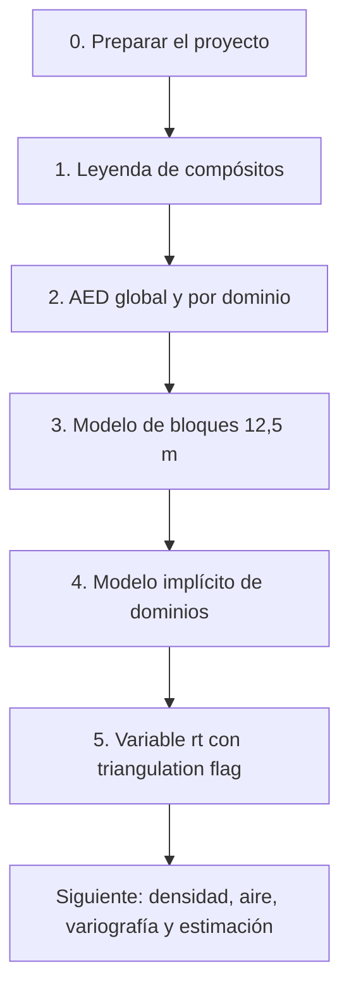

!!! info "Pauta del proyecto"
    En grupos de 2 a 3: AED global y por dominio guardado en `.vda_project`; modelo de bloques de
    12,5 × 12,5 × 12,5 m (700 × 600 × 900 m); implícito de dominios; cambiar la imagen de la
    topografía; variables aire y topografía con *mine*; `rt` con *triangulation flag*; densidad por
    script (r101 = 2,8 · r102 = 2,7 · r111 = 2,6 · r112 = 2,5); variogramas por elemento y dominio;
    ID², kriging simple y ordinario con y sin capping; categorización; curvas tonelaje-ley e
    inventario. Cada archivo lleva las iniciales del grupo (aquí, **VHPM**).

---

## 0. Preparar el proyecto

1. Descomprimir `GEOL902.zip` en `C:\Vulcan_Home\proyecto\`.
2. Con Vulcan **cerrado**, renombrar la carpeta `INICIALES_GEO404` con las iniciales del grupo.
3. Abrir Vulcan y elegir la carpeta que contiene **`DEMO.dg1`** (el archivo de proyecto).

!!! question "¿Por qué se hace cada cosa?"
    - **Renombrar al principio:** Vulcan guarda rutas dentro de cada especificación (`.bef`,
      `.im.spec`, `.vda_project`). Si la carpeta cambia de nombre al final, esas rutas quedan
      apuntando a una carpeta que no existe.
    - **La carpeta con `DEMO.dg1`:** si se abre la carpeta de arriba, Vulcan no encuentra el
      proyecto y pide crear uno nuevo (ventana *Project Setup*). Si igual hay que crearlo, se usa
      lo mismo que el original: `DEMO`, prefijo `GEO`, entorno `STD`.

!!! tip "Los datos son los del laboratorio"
    `ld.cmp.isis` de esta base es idéntico al de los laboratorios: 10.478 compósitos de ~5,2 m con
    Au, Cu y el dominio `RTTEXT`. Lo nuevo es la topografía `medio_topo.00t` y su textura.

---

## 1. Leyenda para ver los compósitos por dominio

1. **Analyse → Legend Editor…**
2. Bajo **SAMPLES**, doble clic en `[*] New Legend` → nombre `VHPM_RT`.
3. **Scheme Type: Alpha** y una fila por dominio.
4. Guardar (disquete) y cargar los compósitos con *Samples field* `RTTEXT` y la leyenda.

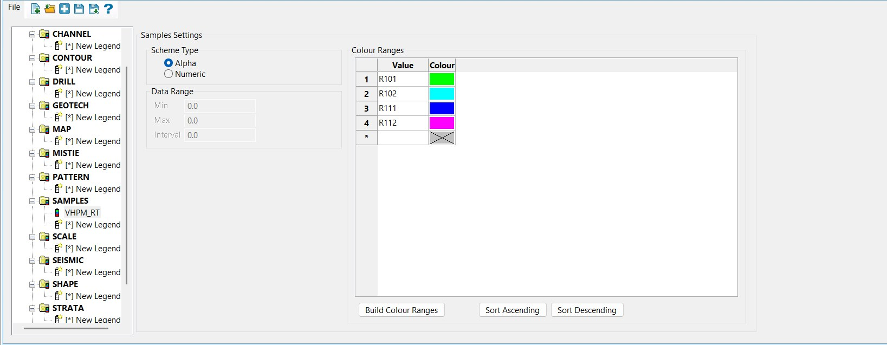{ loading=lazy }

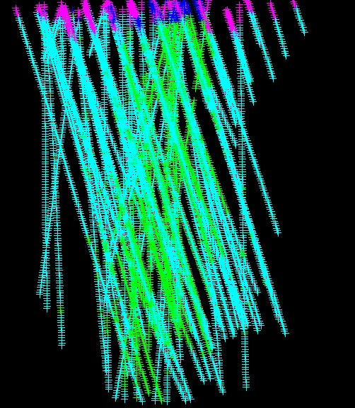{ width="380" loading=lazy }

!!! question "¿Por qué se hace cada cosa?"
    - **Alpha y no Numeric:** `RTTEXT` es texto (`R101`), no un número.
    - **Ver la geometría antes de calcular:** R111 y R112 solo aparecen en la parte alta de los
      sondajes (óxidos); R101 forma cuerpos rodeados por R102 (núcleo y halo). Esa lectura
      guía todo lo que viene: el AED, el implícito y la estimación.

!!! bug "Errores comunes"
    - **Los compósitos no aparecen:** los valores de la leyenda tienen que calzar letra por letra.
      `r101` en minúscula no es `R101`, y esos puntos no se dibujan.
    - **No deja dar OK en *Load Samples*:** con *Samples Colour* marcado hay que elegir campo y
      leyenda; la leyenda debe existir antes.
    - **El Legend Editor no deja marcar nada:** `[*] New Legend` es solo la entrada para crear
      una; se crea con doble clic.

---

## 2. AED global y por dominio

1. **Analyse → Data Analyser…** La base se carga sola; dejar el filtro **Positive**.
2. **File → Save As** → `VHPM_AED_global.vda_project` (antes de empezar).
3. **Stats → General Stats** con AU y CU bajo **UnDomained** y luego bajo **RTTEXT**.
4. **Histogramas** con *Use Logarithmic Bins* (inicio 0,005; 40 clases, 20 en R111 y R112).
5. **Gráficos de probabilidad log-normal**, uno por variable y dominio.
6. **Box plot** de los 4 dominios juntos, eje Y logarítmico y *Show outliers*.
7. Guardar copias por dominio: `VHPM_AED_R101.vda_project`, etc.

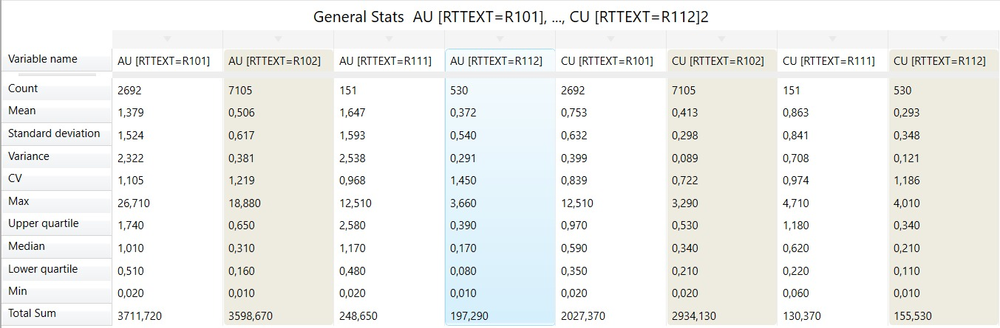{ loading=lazy }

| Dominio | n | Au media (g/t) | Au CV | Au máx | Cu media (%) | Cu CV | Cu máx |
|---|---|---|---|---|---|---|---|
| **Global** | 10.478 | 0,740 | **1,395** | 26,71 | 0,501 | **0,904** | 12,51 |
| R101 | 2.692 | 1,379 | 1,105 | 26,71 | 0,753 | 0,839 | 12,51 |
| R102 | 7.105 | 0,506 | 1,219 | 18,88 | 0,413 | 0,722 | 3,29 |
| R111 | 151 | 1,647 | 0,968 | 12,51 | 0,863 | 0,974 | 4,71 |
| R112 | 530 | 0,372 | 1,450 | 3,66 | 0,293 | 1,186 | 4,01 |

!!! question "¿Por qué se hace cada cosa?"
    - **Global y por dominio:** el CV global de Au (1,395) baja en R101 (1,105) y R102 (1,219),
      que suman el 93 % de los datos. Mezclar poblaciones con medias distintas infla la
      variabilidad: es el argumento para estimar por dominio.
    - **La media global engaña:** 0,740 g/t queda cerca de R102 (0,506) porque R102 tiene el 68 %
      de los compósitos. Estimar todo junto subestima R101 y sobreestima R102.
    - **Escala logarítmica:** las leyes tienen cola larga (media 0,74 contra mediana 0,41 g/t de Au).
      En escala lineal, todo queda apretado contra el cero.
    - **Filtro Positive:** deja fuera valores cero o negativos, como un -99 de "sin dato".

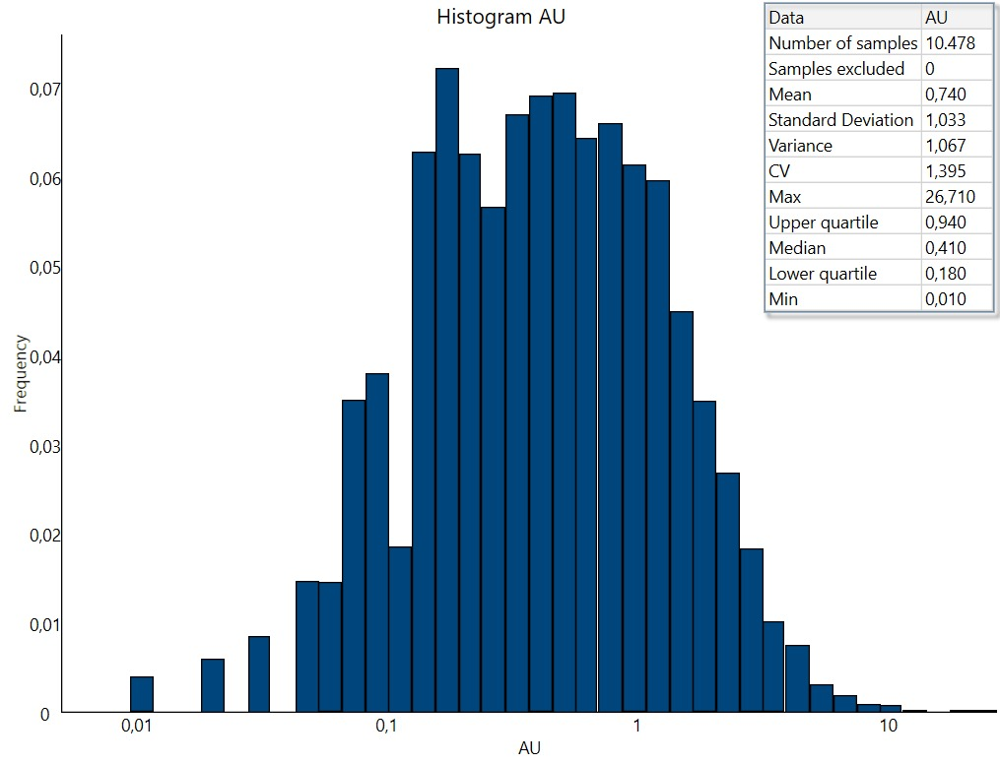{ loading=lazy }

El histograma global de Au tiene **dos modas** (~0,18 y ~0,5 g/t): es R101 sumado a R102.

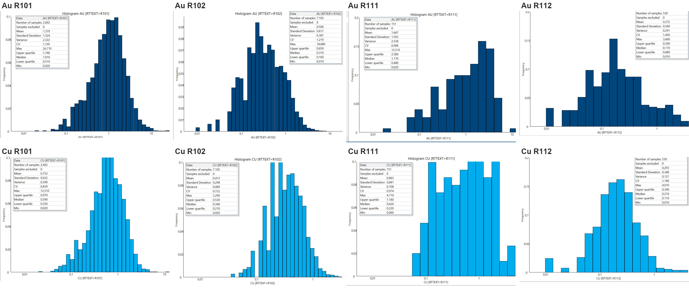{ loading=lazy }

### El capping se decide en el gráfico de probabilidad

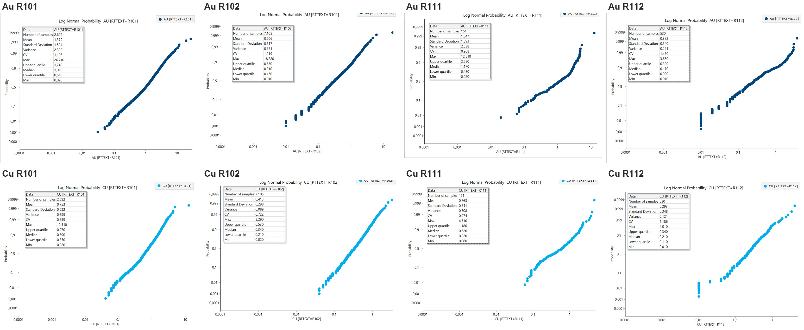{ loading=lazy }

| Dominio | Au: valores más altos (g/t) | Au capping | Cu: valores más altos (%) | Cu capping |
|---|---|---|---|---|
| R101 | 26,71 · 22,59 · 19,13 · 16,31 · 13,86 | ~12 | 12,51 · 6,02 · 4,83 | ~5 |
| R102 | 18,88 · 9,55 · 7,48 | ~7,5 | 3,29 · 3,08 · 2,73 (continuo) | sin capping |
| R111 | 12,51 · 5,35 · 4,87 | ~5,4 | 4,71 · 4,04 · 3,79 | ~4 (opcional) |
| R112 | 3,66 · 2,99 · 2,97 | ~3 | 4,01 · 3,28 · 2,60 · 2,33 | ~2 |

!!! question "¿Por qué el gráfico de probabilidad y no el histograma?"
    Una población log-normal es una campana en el histograma log, pero una **recta** en el gráfico
    de probabilidad. Cuesta ver si una campana está "bien formada"; cualquiera nota cuándo una recta
    se corta. El capping va **donde los puntos se separan de la recta**, y debe afectar a pocos datos
    (menos de ~1 %). Cu R102 es una recta continua hasta 3,29 %: no necesita capping.
    Más detalle en [Cómo interpretar un gráfico de probabilidad](../interpretacion/probabilidad.md).

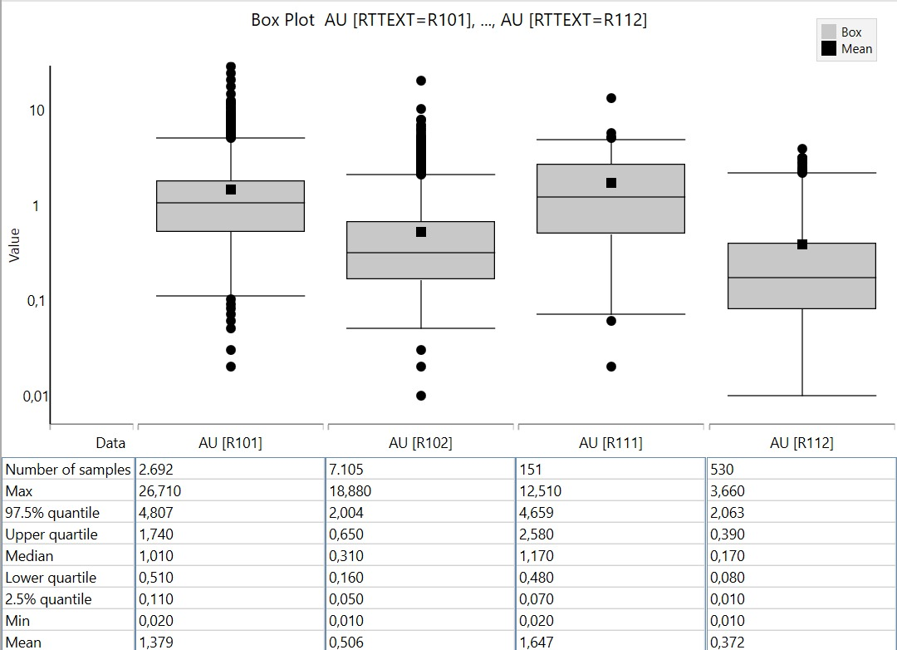{ loading=lazy }

!!! note "Box plot de Vulcan"
    Con *Whisker limit = Quantiles*, los bigotes van del cuantil 2,5 % al 97,5 %. Siempre hay puntos
    fuera (el 2,5 % a cada lado), así que **no todos son outliers**: los que importan son los que se
    separan de la columna de puntos. El box plot sirve para *mostrar*; el gráfico de probabilidad,
    para *decidir*.

!!! bug "Errores comunes"
    - **Barras cortadas en el histograma:** el eje Y queda fijo en 0,1. Se corrige en
      *Axes → Y Axis* subiendo el máximo.
    - **Peineta en Cu R102:** barras altas junto a barras vacías en escala log. Es el redondeo a 2
      decimales (0,10; 0,11…), no geología.
    - **Cu = 12,51 % en R101** duplica al siguiente valor (6,02 %) y coincide con el máximo de Au de
      R111: candidato a error de digitación, no solo a outlier.

---

## 3. Modelo de bloques de 12,5 m

1. **Block → Construction → Define**.
2. *Orientation/Schemes*: origen 0/0/0, bearing 90, plunge 0, dip 0.
3. Fila 1 de *Schemes*: `parent`, Start 0/0/0, End **700/600/900**, bloques **12,5/12,5/12,5**.
   Las columnas *Blocking Maximum* van vacías. Formato *Extended*.
4. *Variables*: `au` y `cu`, Float, default **-99**.
5. Guardar con **Save As** (último ícono de *Output*) → `VHPM_mb125.bdf`.
6. **Create Model** → `VHPM_mb125.bmf`. Verificar con clic derecho → **Header**.

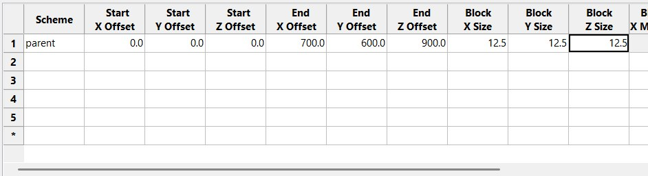{ loading=lazy }

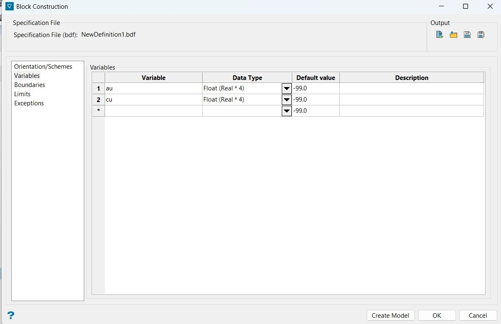{ loading=lazy }

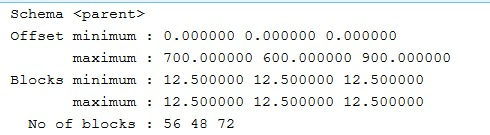{ loading=lazy }

!!! question "¿Por qué se hace cada cosa?"
    - **Origen 0/0/0 sin rotación:** los compósitos van de X 58–552, Y 5–600 y Z 24–859; con
      700 × 600 × 900 m quedan todos dentro.
    - **12,5 m:** cerca de un cuarto o un tercio del espaciamiento entre sondajes y de una altura de
      banco típica. Bloques mucho más chicos se estiman con datos lejanos y quedan suavizados.
    - **Sin sub-bloques:** la pauta pide 12,5 m y simplifica estimación y cubicación.
    - **Default -99 y no 0:** distingue "no estimado" de una ley cero real.
    - **Blocking Maximum vacío:** esas columnas fusionan bloques vecinos iguales para ahorrar
      espacio; no son sub-bloques.

!!! bug "Errores comunes"
    - **Aviso "NewDefinition1.bdf has been modified":** la definición aún no tiene nombre. Poner
      *Cancel* y guardar con *Save As*; con *Yes* queda con un nombre sin iniciales.
    - **El `.bmf` pesa 4 KB:** es normal recién creado; todos los bloques tienen el default y Vulcan
      solo guarda la geometría. Crece al asignar valores.
    - **No deja apretar *Load*:** el modelo ya está abierto (por eso *Close* está activo).

---

## 4. Modelo implícito de dominios

**Geology → Implicit Modelling → Implicit Modelling Editor**

| Página | Configuración |
|---|---|
| Open Specifications | `VHPM_dominios` · **radial basis function** · **Categorical** · `ld.cmp.isis` · Record `ENTRY` · Field `RTTEXT` · X/Y/Z = `MIDX/MIDY/MIDZ` |
| Parameters | **As source** · **Limit Solids by Topography** `medio_topo.00t`, *Full cell* · suavizado **3 / 3** |
| Block Model | **`VHPM_implicito`** (modelo aparte) · 12,5 m · 0–700 / 0–600 / 0–900 · bearing 90 |
| Domains | prefijo `VHPM_` · R101 y R102: tendencia **150/150/100** · R111 y R112: **150/150/30** |

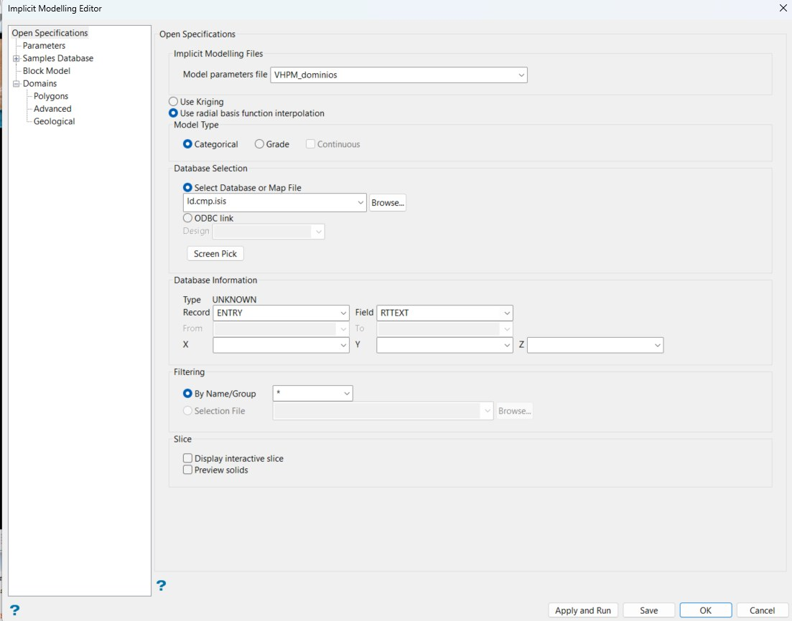{ loading=lazy }

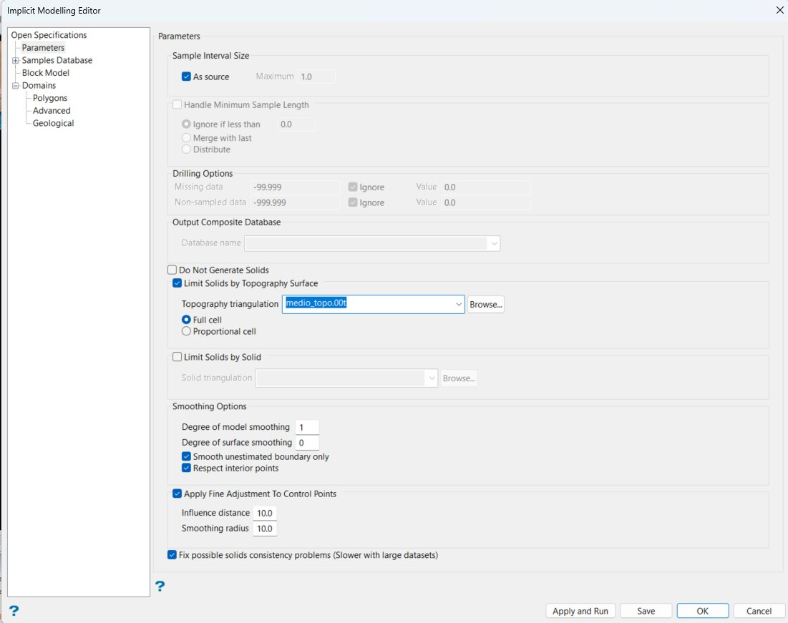{ loading=lazy }

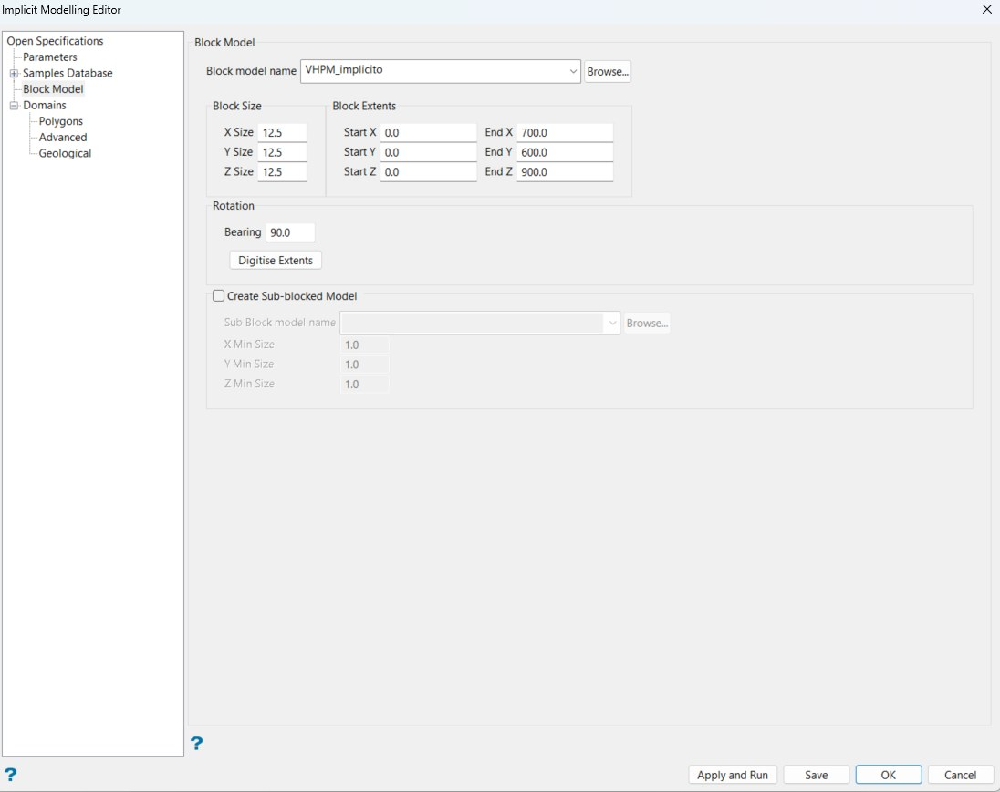{ loading=lazy }

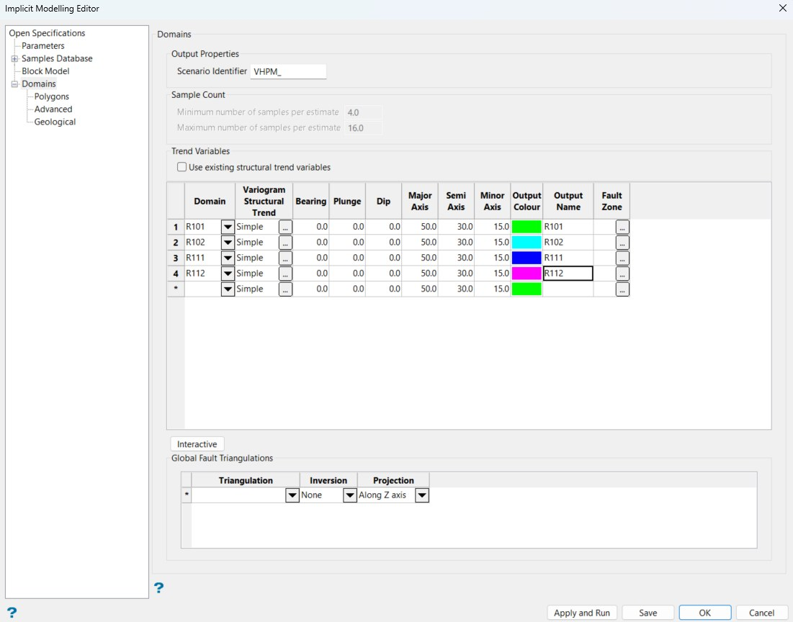{ loading=lazy }

**Save → Apply and Run.** Resultado: `VHPM_R101.00t`, `VHPM_R102.00t`, `VHPM_R111.00t`, `VHPM_R112.00t`.

!!! question "¿Por qué se hace cada cosa?"
    - **RBF y no kriging:** aquí no se estiman leyes, se dibujan contactos. RBF no necesita
      variograma y es el estándar para modelar geología.
    - **Categorical:** se modelan categorías (R101, R102…), no valores continuos.
    - **From/To en gris, X/Y/Z con MIDX…:** Vulcan trata la base como puntos; el punto medio
      representa cada compósito de ~5 m, suficiente para bloques de 12,5 m.
    - **As source:** sin esto Vulcan re-divide los compósitos en tramos de 1 m sin ganar nada.
    - **Límite por topografía:** sin él, los sólidos pueden salir sobre la superficie (roca en el
      aire) e inflar el tonelaje.
    - **Modelo de bloques aparte:** el implícito escribe sus propias variables; apuntarlo al modelo
      principal lo ensucia. La pauta pide crear `rt` con *triangulation flag*, que es otro paso.
    - **Minor 30 en los óxidos:** con rotación 0 el eje *Minor* es vertical. R111 y R112 son capas
      de ~90 m de espesor y cientos de metros de extensión; con 100 m el óxido se "estira" hacia
      abajo y se come sulfuros.

### Primera corrida contra versión final

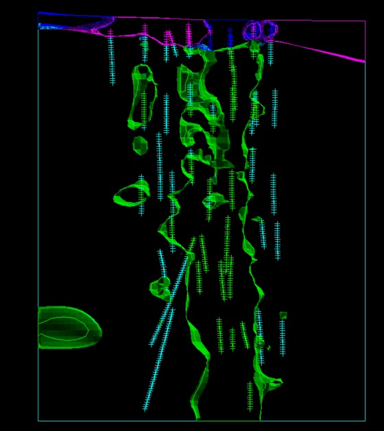{ width="320" loading=lazy }
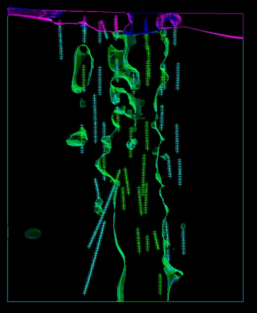{ width="320" loading=lazy }

| | Primera corrida (50/30/15, suavizado 1/0) | Final (150/150/100, suavizado 3/3) |
|---|---|---|
| Contornos de R101 | Dentados | Más suaves |
| Cuerpo sin datos a la izquierda | Grande (~90 m) | Mucho más chico |
| Compósitos dentro de su sólido | Sí | Sí |

!!! question "¿Por qué cambió el resultado?"
    Con alcances de 50 m, menores que el espaciamiento entre sondajes (~30–50 m en esta sección),
    el RBF no conecta tramos de sondajes vecinos y dibuja una burbuja por sondaje. Subir más el
    suavizado no conviene: R101 está **intercalado** con R102 dentro de los sondajes, y un sólido
    forzado a ser continuo absorbería compósitos R102.

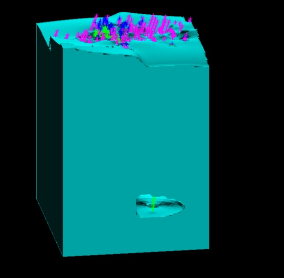{ width="380" loading=lazy }

!!! note "Limitaciones para comentar"
    - **R102 llena toda la caja:** en un modelo categórico cada celda pertenece a algún dominio, y
      lejos de los datos "gana" el más abundante. Esos bloques no tendrán muestras cerca al estimar.
    - **R101 llega a Z = 0:** la mineralización queda abierta en profundidad.

!!! bug "Errores comunes"
    - **Se ve igual después de volver a correr:** Vulcan tiene en memoria los sólidos anteriores.
      Hay que descargarlos (*Loaded Items → Vulcan*) y volver a cargarlos.
    - **Aparece `mkgroup.exe.stackdump`:** error interno de la consola de Vulcan; no afecta los
      resultados. Borrarlo antes de entregar.

---

## 5. Variable `rt` con triangulation flag

1. Clic derecho en `VHPM_mb125.bmf` → **Add Variable** → `rt`, **Integer**, default **0**.
2. **Block → Manipulation → Triangulation Flag…**
    - Specification file `VHPM_flag_rt`, Scenario ID `rt_v1`, modelo `VHPM_mb125.bmf`.
    - **Use block centroids**; *Create block model variables* sin marcar.

| Triangulation | Variable | Value | Priority | Inversion | Projection |
|---|---|---|---|---|---|
| VHPM_R102.00t | rt | 102 | 1 | **None** | **Along Z axis** |
| VHPM_R101.00t | rt | 101 | 1 | None | Along Z axis |
| VHPM_R112.00t | rt | 112 | 1 | None | Along Z axis |
| VHPM_R111.00t | rt | 111 | 1 | None | Along Z axis |

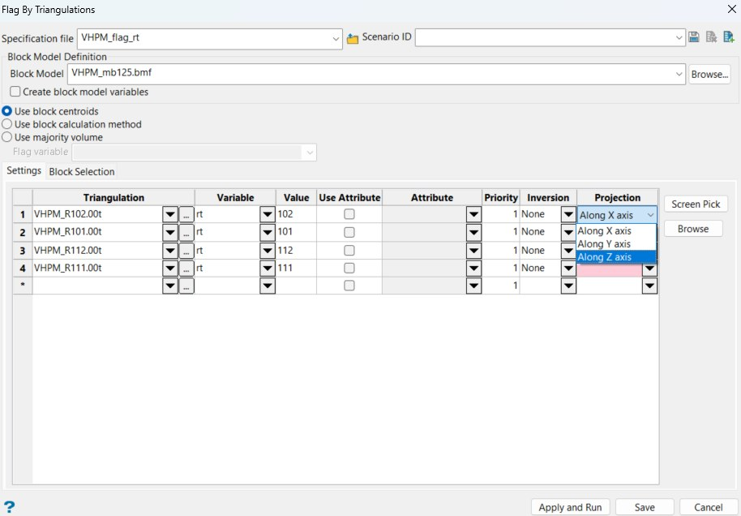{ loading=lazy }

3. **Save → Apply and Run.** No abre consola; el `.bmf` pasa de 4 KB a ~780 KB.

!!! question "¿Por qué se hace cada cosa?"
    - **`rt` numérica:** la densidad se define por código (r101 = 2,8…), y así el script es simple.
      El default **0** significa "fuera de todo sólido", es decir, aire.
    - **Centroides:** cada bloque toma el dominio de su centro; no hay bloques "mitad y mitad".
    - **Inversion None:** marca lo que está *dentro*. *Partial* y *Complete* marcan lo de *fuera*.
    - **Along Z:** para un sólido cerrado da lo mismo el eje (Vulcan cuenta cruces de la superficie);
      Z es la convención.
    - **Orden R102 primero:** si dos sólidos se tocan, el último sobrescribe. Partir por el grande
      protege a los chicos.

### Verificar `rt`

1. Legend Editor → **BLOCK** → `VHPM_RT_BLK`, *Numeric*, **Range Mode GELE**, 101–101, 102–102…
2. Clic derecho en el `.bmf` → **View Blocks**: `rt`, **XZ rectangle**, scheme file `geo.scd`.
3. *Block Selection*: Section thickness `12.5`, Condition **`rt gt 0`**, Use block centres → Northing 300.

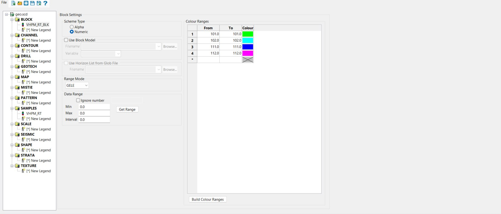{ loading=lazy }

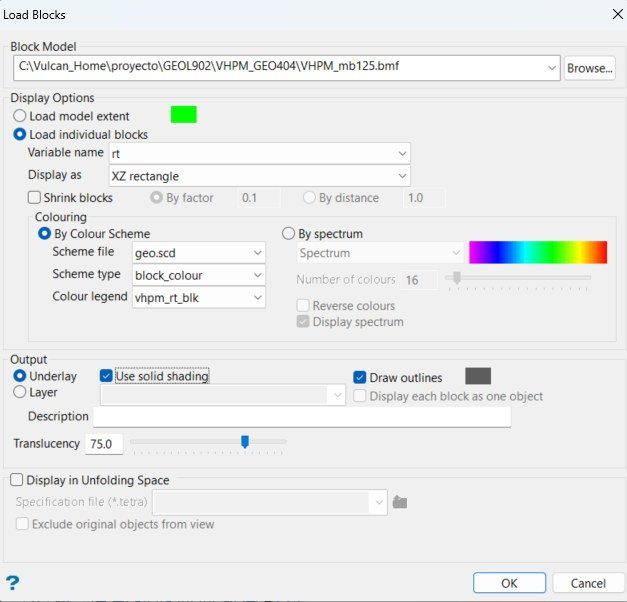{ loading=lazy }

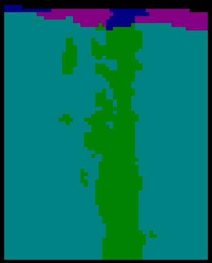{ width="380" loading=lazy }

Resultado: **3.864 bloques**. Una fila tiene 56 × 72 = 4.032 bloques; la diferencia, 168 = 56 × 3,
son las 3 capas de aire sobre la topografía. Todo lo que está bajo la superficie quedó con dominio.

!!! bug "Errores comunes"
    - **"0 matching blocks":** Vulcan escribe las condiciones al estilo Fortran: `rt gt 0`, no
      `rt > 0` (`ge`, `eq`, `lt`…).
    - **Bloques sin color:** con *Range Mode GELT* el rango 101–101 significa "≥ 101 y < 101", que
      nada cumple. Usar **GELE**.
    - **La leyenda no aparece en *Load Blocks*:** el scheme file por defecto es `exp.scd`; las
      leyendas nuevas quedaron en `geo.scd`.
    - **Colores muy oscuros:** desmarcar *Use solid shading* y dejar la translucencia en 0.
    - **Campo que solo deja escribir una letra:** pegar el texto con Ctrl+V o elegir con la flecha.
    - **Bloques cargados como *Underlay*:** se borran con **File → Underlays → Remove**.

---

## Resultados y observaciones críticas

- Los dominios se justifican con números: el CV baja al separarlos y R101 y R111 quedan claramente
  sobre R102 y R112 en el box plot.
- Capping propuesto en los dominios con valores aislados; Cu R102 no lo necesita.
- R101 está intercalado con R102: el implícito lo representa como varios cuerpos, no como un núcleo.
- Los bloques lejanos a los sondajes quedan como R102 sin datos cerca: no deberían recibir ley o
  serán inferidos.

!!! warning "Antes de seguir: la densidad del aire"
    Al crear `densidad`, el aire (`rt = 0`) debe quedar con **0**, no con -99. Con -99, la media de la
    densidad sale negativa y, peor, en la cubicación (volumen × densidad) esos bloques aportan
    **tonelaje negativo**. Los bloques de aire no se borran: se marcan y se excluyen.

## Preguntas de repaso

??? question "¿Por qué la media global de Au (0,74 g/t) no representa al yacimiento?"
    Es un promedio ponderado por cantidad de datos y R102 tiene el 68 % de los compósitos. Queda
    lejos de R101 (1,38) y de R111 (1,65), así que estimar con ella subestima la alta ley.

??? question "¿Qué forma tiene una población log-normal en un gráfico de probabilidad log?"
    Una recta. El capping va donde los valores altos se separan de ella.

??? question "¿Por qué el implícito se escribe en un modelo de bloques aparte?"
    Porque genera variables propias y la variable `rt` del modelo principal se crea con
    *triangulation flag*, que es otra tarea de la pauta.

??? question "Al verificar `rt` aparecen 3.864 bloques en una fila de 4.032. ¿Qué son los 168 restantes?"
    Los bloques de aire: 56 × 3 capas sobre la topografía, con `rt = 0`.

??? question "¿Deberían existir los bloques de aire?"
    Sí. El modelo es una caja y la topografía no es plana. Se marcan (variable aire, densidad 0) y se
    excluyen de la cubicación; el optimizador de rajo los necesita porque sacarlos no cuesta nada.
